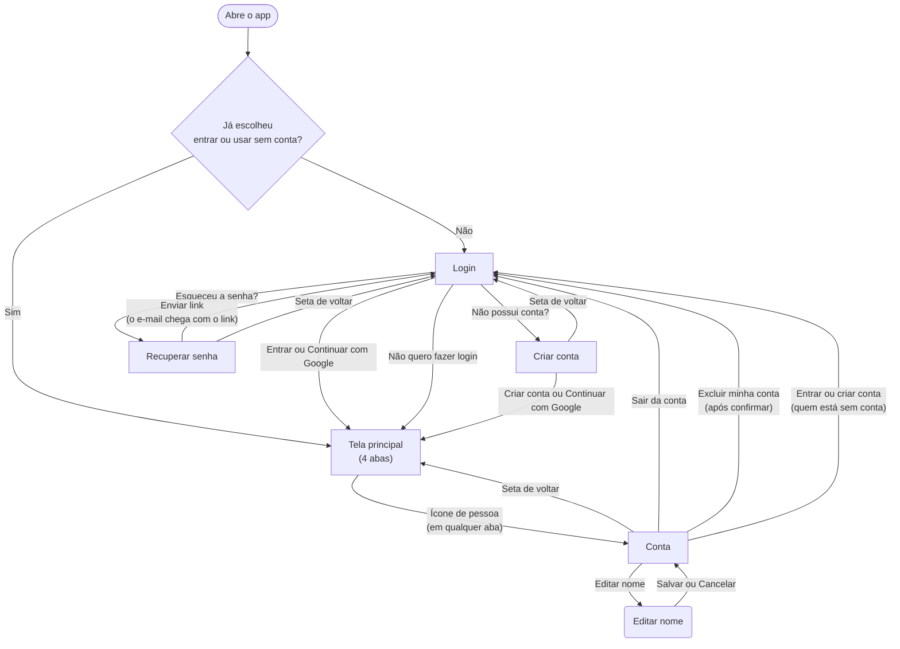
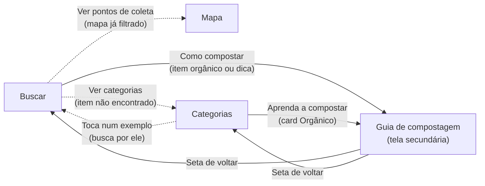
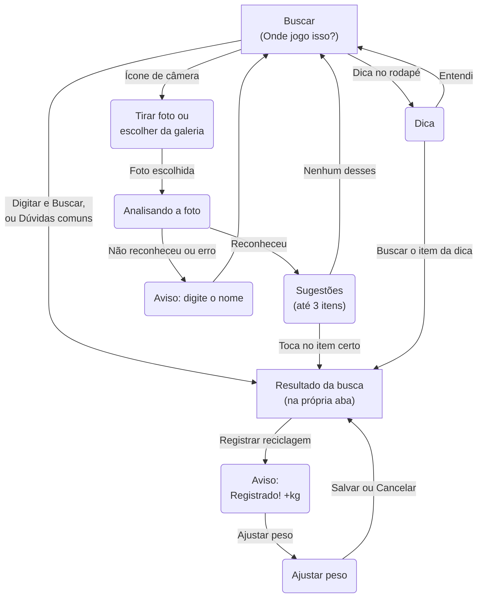
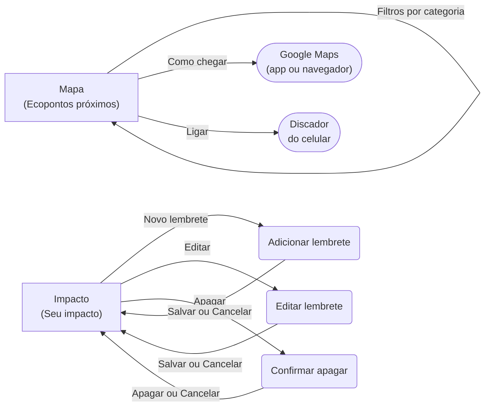

# Fluxo de navegação

Como as telas do LixoZero se conectam no aplicativo pronto (item b-v do Projeto da Unidade II). Este fluxo foi escrito a partir do código (`lib/app.dart`, `lib/state/navegacao_model.dart` e as telas em `lib/screens/` e `lib/widgets/`), e não do protótipo.

**Como ler os diagramas:**

- Retângulo com cantos retos: tela inteira.
- Retângulo arredondado: janela que abre por cima da tela (diálogo ou folha inferior).
- Retângulo com cantos muito redondos: outro aplicativo do celular.
- Losango: decisão do app.
- A seta traz o botão ou a ação que faz a troca. Seta pontilhada: troca de aba.

## 1. Entrada e conta

Ao abrir, o app só mostra o login se a pessoa ainda não escolheu entre entrar e usar sem conta. A escolha fica salva no aparelho, então nas próximas aberturas o app vai direto para a tela principal.

## 2. Tela principal

A tela principal tem uma **barra inferior com 4 abas** (Buscar, Mapa, Impacto e Categorias), e de qualquer aba dá para ir a qualquer outra. Cada aba só é aberta na primeira vez que a pessoa toca nela, e o pedido de permissão de localização só aparece ao entrar no Mapa. O ícone de pessoa que abre a Conta fica no topo das quatro abas (seção 1).

### 2.1 Entre as abas e as telas secundárias

Estas são as ligações entre as telas feitas por botões dentro delas, além da barra inferior. As setas pontilhadas trocam de aba. A Compostagem é a única tela secundária (a Conta está na seção 1) e fecha com a seta de voltar, devolvendo a pessoa à aba de onde veio.

### 2.2 Aba Buscar

O resultado da busca aparece na própria aba. A busca por foto abre janelas por cima da tela, e a dica do rodapé também.

### 2.3 Abas Mapa e Impacto

## 3. O que cada tela mostra e a quais telas leva

| Tela | O que tem | Para onde vai |
|---|---|---|
| **Login** | E-mail, senha, Entrar, Continuar com Google e Não quero fazer login | Tela principal, Criar conta ou Recuperar senha |
| **Criar conta** | Nome, sobrenome, e-mail, senha e confirmação | Tela principal ou volta ao Login |
| **Recuperar senha** | E-mail e Enviar link | Volta ao Login |
| **Buscar** | Campo de busca, câmera, dúvidas comuns, resultado, dica do rodapé | Mapa, Categorias, Compostagem e as janelas da foto, da dica e do ajuste de peso |
| **Mapa** | Lista e mapa dos ecopontos e cooperativas, filtros, aviso de sem internet | Google Maps (Como chegar) e discador (Ligar) |
| **Impacto** | Quilos do mês e totais, lista de lembretes | Janelas de adicionar, editar e apagar lembrete |
| **Categorias** | As 6 categorias com cor, lixeira e exemplos | Buscar (toca num exemplo) e Compostagem (card Orgânico) |
| **Guia de compostagem** | O que pode e não pode ir, passo a passo, problemas comuns | Volta à aba de onde veio |
| **Conta** | Nome, e-mail, estado da sincronização, editar nome, sair, excluir | Login (sair, excluir ou entrar) ou volta à tela principal |

## 4. Observações

- **Quatro telas principais.** O RNF10 limita o app a 4 telas principais. A Compostagem e a Conta são telas secundárias, abertas por cima da tela principal, e por isso o app continua com as 4 abas.
- **Visitante e conta usam as mesmas telas.** A diferença é só o que acontece com os dados: sem conta, ficam no aparelho; com conta, também são sincronizados com o Firestore. Quem não tem conta vê "Entrar ou criar conta" na tela Conta.
- **Sem internet.** Todas as telas abrem. O Mapa mostra a lista e o aviso de sem internet, e as telas que dependem de rede (entrar, criar conta, recuperar senha, editar nome e excluir conta) mostram uma mensagem em vez de travar.
- **Voltar.** O botão voltar do Android fecha as janelas abertas e volta das telas secundárias (Conta e Compostagem). Dentro da tela principal, ele sai do app, porque trocar de aba não empilha telas.
