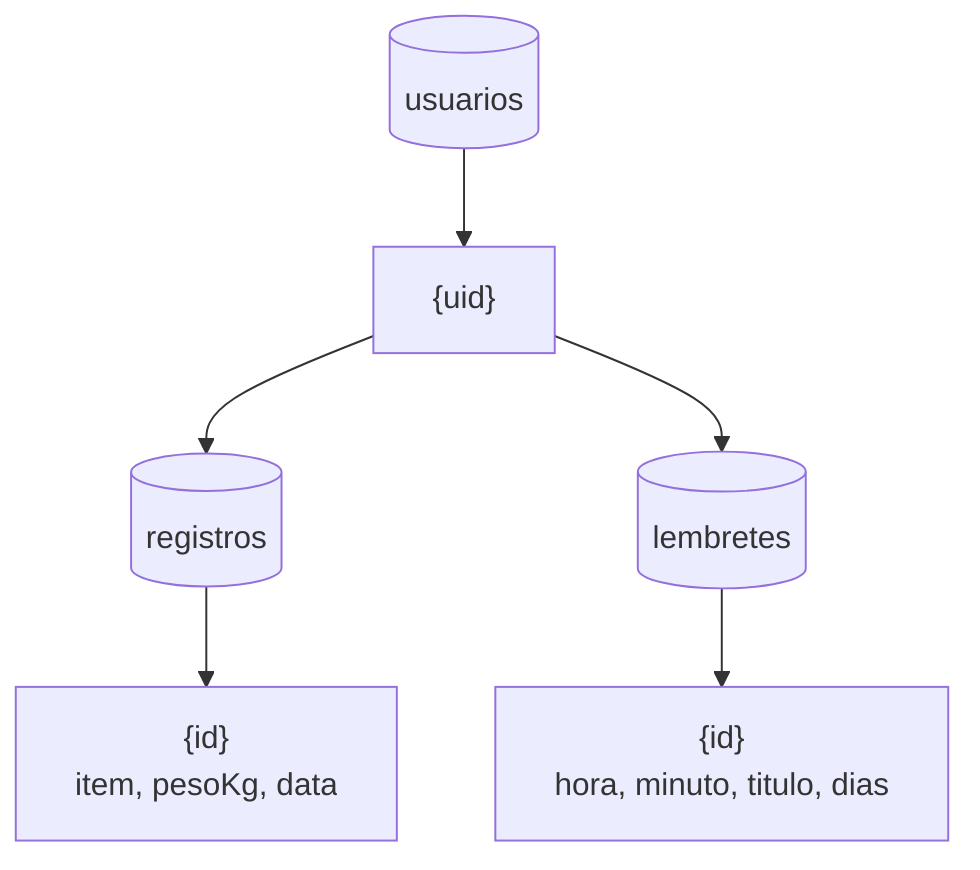
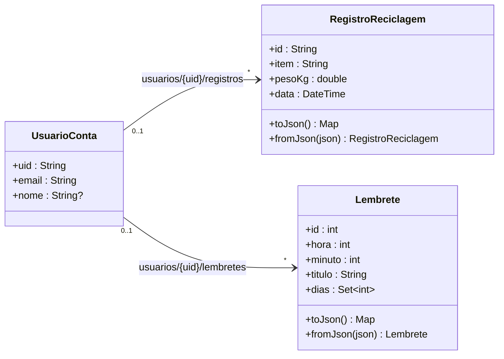

# Modelagem do banco de dados

Este documento descreve a estrutura de coleções e documentos do LixoZero no Firebase e como as
classes de domínio em Dart se mapeiam para o Firestore, conforme os itens b-iii e b-iv do Projeto
da Unidade II.

O aparelho é a fonte principal dos dados. O Firestore guarda uma cópia só para quem cria conta.
Quem escolhe "Não quero fazer login" não envia nada para a nuvem (RNF06 e RNF07).

## Onde cada dado fica

| Dado | Onde fica | Quem tem |
|---|---|---|
| Guia de classificação, ecopontos, compostagem e dicas | JSON dentro do app (`assets/data/`) | Todos, sem internet |
| Registros de reciclagem e lembretes | Aparelho (`shared_preferences`) | Todos |
| Cópia dos registros e lembretes | Firestore (`usuarios/{uid}`) | Só quem tem conta |
| Nome, e-mail e senha da conta | Firebase Authentication | Só quem tem conta |
| Escolha de seguir sem login e número da última dica vista | Aparelho (`shared_preferences`) | Todos |
| Localização do GPS | Não é guardada; só ordena os ecopontos | — |

O guia, os ecopontos e o conteúdo de compostagem não vão para o Firestore. Eles são editados pela
equipe e vêm dentro do app, para funcionar offline (tabela CRUD do `requisitos.md`).

## Estrutura de coleções e documentos

```text
usuarios                          (coleção)
 └── {uid}                        (documento: um por usuário com conta)
      ├── registros               (subcoleção)
      │    └── {id}               (documento: um registro de reciclagem)
      │         item    : string
      │         pesoKg  : number
      │         data    : timestamp
      └── lembretes               (subcoleção)
           └── {id}               (documento: um lembrete de coleta)
                hora    : number
                minuto  : number
                titulo  : string
                dias    : array<number>   (1 a 7)
```



O `{uid}` é o identificador que o Firebase Authentication dá à conta. Ele liga os dados ao usuário
sem guardar nome ou e-mail no banco.

## Como as classes Dart se mapeiam para o Firestore



### UsuarioConta → `usuarios/{uid}`

| Atributo Dart | Tipo Dart | No Firebase |
|---|---|---|
| `uid` | `String` | Id do documento em `usuarios` |
| `email` | `String` | Fica no Firebase Authentication |
| `nome` | `String?` | Fica no Firebase Authentication |
| `nomeExibicao` (derivado) | `String` | Não é salvo; calculado no app |

### RegistroReciclagem → `usuarios/{uid}/registros/{id}`

| Atributo Dart | Tipo Dart | Campo no Firestore | Tipo no Firestore |
|---|---|---|---|
| `id` | `String` | Id do documento | — |
| `item` | `String` | `item` | string |
| `pesoKg` | `double` | `pesoKg` | number |
| `data` | `DateTime` | `data` | timestamp |

Exemplo de documento:

```jsonc
// usuarios/{uid}/registros/{id}
{
  "item": "Garrafa PET",
  "pesoKg": 0.03,
  "data": "24 de novembro de 2026 às 10:35 (timestamp)"
}
```

### Lembrete → `usuarios/{uid}/lembretes/{id}`

| Atributo Dart | Tipo Dart | Campo no Firestore | Tipo no Firestore |
|---|---|---|---|
| `id` | `int` | Id do documento | texto (o id do Firestore é sempre texto) |
| `hora` | `int` | `hora` | number |
| `minuto` | `int` | `minuto` | number |
| `titulo` | `String` | `titulo` | string |
| `dias` | `Set<int>` | `dias` | array de number (1 a 7) |
| `horario`, `descricaoDias`, `resumo` (derivados) | `String` | Não são salvos; calculados no app | — |

Exemplo de documento:

```jsonc
// usuarios/{uid}/lembretes/{id}
{
  "hora": 8,
  "minuto": 0,
  "titulo": "Lixo Orgânico",
  "dias": [2]
}
```

### Conversão

- `toJson()` transforma o objeto Dart no mapa gravado no documento.
- `fromJson(json)` reconstrói o objeto a partir do documento lido.
- A conversão entre os tipos (`DateTime` ↔ timestamp, `Set<int>` ↔ array) fica no
  `lib/services/nuvem_repositorio.dart`.
- Atributos derivados (marcados com `/` no diagrama de classes) não vão para o banco.

## Operações do `NuvemRepositorio`

O app só conversa com o contrato `NuvemRepositorio`. A implementação real é a `NuvemFirestore`. A
`NuvemIndisponivel` é usada quando o Firebase não está configurado, e os testes usam uma versão
falsa.

| Método | Caminho no Firestore | Operação |
|---|---|---|
| `lerRegistros(uid)` | `usuarios/{uid}/registros` | Lê todos os documentos |
| `gravarRegistro(uid, registro)` | `usuarios/{uid}/registros/{id}` | Cria ou substitui o documento |
| `lerLembretes(uid)` | `usuarios/{uid}/lembretes` | Lê todos os documentos |
| `gravarLembrete(uid, lembrete)` | `usuarios/{uid}/lembretes/{id}` | Cria ou substitui o documento |
| `apagarLembrete(uid, id)` | `usuarios/{uid}/lembretes/{id}` | Apaga o documento |
| `apagarTudo(uid)` | `usuarios/{uid}` e subcoleções | Apaga tudo antes de excluir a conta |

Não existe operação para apagar um registro de reciclagem sozinho: pela tabela CRUD, o registro só
é apagado junto com a conta.

## Sincronização

O `SincronizacaoModel` decide quando sincronizar: ao entrar na conta e quando a internet volta. O
estado aparece na tela Conta.

| Estado (`EstadoSincronizacao`) | Quando acontece |
|---|---|
| `semConta` | O usuário escolheu não fazer login |
| `aguardandoInternet` | Tem conta, mas está offline |
| `sincronizando` | Enviando e recebendo dados |
| `sincronizado` | Aparelho e nuvem iguais |
| `erro` | A sincronização falhou |

Regras:

- O que só existe de um lado vai para o outro.
- Se o mesmo registro tiver valores diferentes, vale o do aparelho.
- Sem internet, o Firestore guarda a gravação e envia quando a conexão volta.
- Ao excluir a conta, os dados da nuvem são apagados antes (`apagarTudo`).

## Regras de segurança

O `firestore.rules` garante que cada usuário só lê e grava o que está dentro de
`usuarios/{seu uid}`. Além disso:

- Cada subcoleção tem a sua regra, e um documento só é gravado se tiver exatamente os campos da
  modelagem, com os tipos certos.
- Registros precisam de `pesoKg` maior que zero e `data` como timestamp.
- Lembretes precisam de `hora` entre 0 e 23, `minuto` entre 0 e 59 e `dias` como lista.
- Qualquer outro caminho do banco é negado.

```text
rules_version = '2';
service cloud.firestore {
  match /databases/{database}/documents {

    function dono(uid) {
      return request.auth != null && request.auth.uid == uid;
    }

    // Registros de reciclagem (RF09): item, pesoKg e data.
    match /usuarios/{uid}/registros/{id} {
      allow read, delete: if dono(uid);
      allow create, update: if dono(uid)
        && request.resource.data.keys().hasOnly(['item', 'pesoKg', 'data'])
        && request.resource.data.item is string
        && request.resource.data.pesoKg is number
        && request.resource.data.pesoKg > 0
        && request.resource.data.data is timestamp;
    }

    // Lembretes de coleta (RF04): hora, minuto, titulo e dias da semana (1 a 7).
    match /usuarios/{uid}/lembretes/{id} {
      allow read, delete: if dono(uid);
      allow create, update: if dono(uid)
        && request.resource.data.keys().hasOnly(['hora', 'minuto', 'titulo', 'dias'])
        && request.resource.data.hora is int
        && request.resource.data.hora >= 0 && request.resource.data.hora <= 23
        && request.resource.data.minuto is int
        && request.resource.data.minuto >= 0 && request.resource.data.minuto <= 59
        && request.resource.data.titulo is string
        && request.resource.data.dias is list;
    }

    // Todo o resto é negado.
    match /{documento=**} {
      allow read, write: if false;
    }
  }
}
```

As regras precisam ser publicadas no console do Firebase: estar no repositório não basta.
